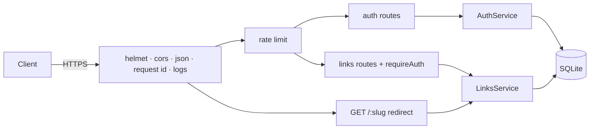

# BAckENd — URL Shortener API

[](https://github.com/TheRealJahaan/BAckENd/actions/workflows/ci.yml)


A production-ready REST API for shortening URLs, built with **Express 5**, **TypeScript**, **Zod** and
**SQLite**. Users sign up, get a JWT, create short links (random or custom slugs, optional expiry),
and see click analytics: clicks per day, unique visitors and top referrers.

It started as a "hello world" Express server and is now a small but complete backend that shows the
things that matter in real services: input validation, auth, consistent errors, security headers,
rate limiting, structured logs, health probes, OpenAPI docs, tests, CI and a container image.

## Features

- **Auth**: register / login with scrypt-hashed passwords and HS256 JWTs. Login failures take the same
  time and return the same error whether or not the email exists, so accounts can't be enumerated.
- **Links**: full CRUD, custom or generated base62 slugs, optional expiry, pagination and search.
  Other users' links return 404, never 403, so IDs can't be probed.
- **Redirects**: `GET /:slug` answers with a 302 and `Cache-Control: no-store` so every click is
  counted; expired links return 410.
- **Analytics**: per-day click series (gap-filled for charts), unique visitors and top referrers.
  Visitor IPs are stored only as salted SHA-256 hashes.
- **Docs**: OpenAPI 3.1 spec generated from the same Zod schemas that validate requests, served with
  Swagger UI at `/docs`. Docs and validation can't drift apart.
- **Production hardening**: Helmet security headers, CORS allow-list, per-route rate limits, 10 kB body
  limit, request IDs (`X-Request-Id`, propagated if supplied), JSON logs with secrets redacted,
  validated environment config, liveness/readiness probes and graceful shutdown.
- **Zero native dependencies**: uses Node's built-in `node:sqlite`, so `npm ci` never compiles anything.

## Quick start

```bash
git clone https://github.com/TheRealJahaan/BAckENd.git
cd BAckENd
npm install
cp .env.example .env        # then set JWT_SECRET (openssl rand -base64 48)
npm run dev                 # http://localhost:4000, docs at /docs
```

Or with Docker:

```bash
docker compose up --build   # http://localhost:4000
```

### Try it

```bash
BASE=http://localhost:4000

TOKEN=$(curl -s -X POST $BASE/api/v1/auth/register \
  -H 'Content-Type: application/json' \
  -d '{"email":"you@example.com","name":"You","password":"a-long-password"}' | jq -r .token)

curl -s -X POST $BASE/api/v1/links \
  -H "Authorization: Bearer $TOKEN" -H 'Content-Type: application/json' \
  -d '{"url":"https://github.com/TheRealJahaan","slug":"jahaan","title":"My GitHub"}' | jq

curl -i $BASE/jahaan                                   # 302 -> https://github.com/TheRealJahaan
curl -s $BASE/api/v1/links -H "Authorization: Bearer $TOKEN" | jq
```

## API

Full, interactive reference: **`/docs`** (Swagger UI) or **`/openapi.json`**.

| Method   | Path                      | Auth | Description                                        |
| -------- | ------------------------- | ---- | -------------------------------------------------- |
| `POST`   | `/api/v1/auth/register`   |      | Create an account, returns `{ user, token }`       |
| `POST`   | `/api/v1/auth/login`      |      | Log in, returns `{ user, token }`                  |
| `GET`    | `/api/v1/auth/me`         | ✓    | Current user                                       |
| `POST`   | `/api/v1/links`           | ✓    | Create a link `{ url, slug?, title?, expiresAt? }` |
| `GET`    | `/api/v1/links`           | ✓    | List your links `?page=1&limit=20&q=search`        |
| `GET`    | `/api/v1/links/:id`       | ✓    | Get one link                                       |
| `PATCH`  | `/api/v1/links/:id`       | ✓    | Update `url`, `slug`, `title`, `expiresAt`         |
| `DELETE` | `/api/v1/links/:id`       | ✓    | Delete a link and its clicks                       |
| `GET`    | `/api/v1/links/:id/stats` | ✓    | Analytics `?days=30`                               |
| `GET`    | `/:slug`                  |      | Redirect (302), 404 if unknown, 410 if expired     |
| `GET`    | `/healthz`, `/readyz`     |      | Liveness and readiness (database) probes           |

Authenticated routes take `Authorization: Bearer <token>`.

### Errors

Every error uses one envelope, so clients only need one code path:

```json
{
  "error": {
    "code": "BAD_REQUEST",
    "message": "Request validation failed",
    "details": [{ "path": "url", "message": "Invalid URL" }],
    "requestId": "5c0d7a8e-…"
  }
}
```

Codes: `BAD_REQUEST`, `INVALID_JSON`, `UNAUTHORIZED`, `INVALID_CREDENTIALS`, `NOT_FOUND`, `CONFLICT`,
`GONE`, `PAYLOAD_TOO_LARGE`, `RATE_LIMITED`, `INTERNAL_ERROR`.

### Rate limits

| Scope               | Limit               |
| ------------------- | ------------------- |
| All `/api` routes   | 300 / 15 min per IP |
| `register`, `login` | 20 / 15 min per IP  |
| Creating links      | 60 / hour per IP    |

Limits are reported with the IETF `RateLimit` / `RateLimit-Policy` headers.

## Architecture

```
src/
├── server.ts              # process entry: open DB, listen, graceful shutdown
├── app.ts                 # createApp({ db }): middleware + routers, no side effects (testable)
├── config/env.ts          # Zod-validated environment, fails fast on bad config
├── db/                    # node:sqlite connection, append-only migrations (PRAGMA user_version)
├── docs/openapi.ts        # OpenAPI 3.1 document generated from Zod schemas
├── lib/                   # errors, JWT, scrypt passwords, slug/ID generation, logger, validation
├── middleware/            # auth, rate limiting, 404 + error handler
└── modules/
    ├── auth/              # schemas → service → routes
    ├── links/             # schemas → service → routes (CRUD, redirect, analytics)
    └── health/
```

Each module follows **schemas → service → routes**. Schemas (Zod) define the contract and power both
validation and the OpenAPI docs. Services hold business rules and SQL and know nothing about HTTP.
Routes are thin: parse input, call the service, send the result. Express 5 forwards thrown and rejected
errors to one error handler, which maps `AppError`s to the JSON envelope and hides unknown errors
behind a generic 500.



### Data model

| Table    | Key columns                                                                         |
| -------- | ----------------------------------------------------------------------------------- |
| `users`  | `id`, `email` (unique, case-insensitive), `name`, `password_hash`                   |
| `links`  | `id`, `user_id` → users, `slug` (unique), `target_url`, `click_count`, `expires_at` |
| `clicks` | `link_id` → links (cascade), `clicked_at`, `referrer` (host), `visitor_hash`        |

**Why SQLite?** For a single-instance service it is fast, has no extra infrastructure, and with WAL
mode handles plenty of read-heavy traffic. The data layer is plain SQL in the services, so moving to
Postgres means changing one module, not the app.

## Configuration

All variables are validated at startup; see [`.env.example`](.env.example).

| Variable          | Default                 | Notes                                              |
| ----------------- | ----------------------- | -------------------------------------------------- |
| `JWT_SECRET`      | **required**            | ≥ 32 chars. `openssl rand -base64 48`              |
| `PUBLIC_BASE_URL` | `http://localhost:4000` | Used to build `shortUrl`s                          |
| `PORT`            | `4000`                  |                                                    |
| `DATABASE_PATH`   | `./data/app.db`         | `:memory:` for an ephemeral DB                     |
| `JWT_EXPIRES_IN`  | `1d`                    | Any [jose](https://github.com/panva/jose) duration |
| `CORS_ORIGIN`     | `*`                     | Comma-separated origins                            |
| `TRUST_PROXY`     | `0`                     | Set to `1` behind Render / Fly / Railway           |
| `LOG_LEVEL`       | `info`                  | `silent` … `trace`                                 |

## Scripts

| Command                 | What it does                            |
| ----------------------- | --------------------------------------- |
| `npm run dev`           | Run with hot reload (tsx)               |
| `npm run build`         | Compile to `dist/`                      |
| `npm start`             | Run the compiled server                 |
| `npm test`              | Run the test suite (Vitest + Supertest) |
| `npm run test:coverage` | Tests with coverage report              |
| `npm run lint`          | ESLint (typescript-eslint)              |
| `npm run typecheck`     | `tsc --noEmit` in strict mode           |
| `npm run check`         | Lint + format check + typecheck + tests |

## Testing

46 integration and unit tests run against a fresh in-memory database per test, covering auth,
validation, ownership checks, pagination/search (including LIKE-wildcard escaping), redirects,
expiry, analytics aggregation, rate limiting, security headers and error handling. Coverage is ~95%.
CI runs everything on Node 22 and 24, then builds the Docker image and smoke-tests it.

## Deployment

The app ships as a small, non-root Docker image with a built-in healthcheck. SQLite needs a persistent
volume mounted at `/data`.

### Fly.io (recommended, free allowance, persistent volume)

```bash
fly launch --copy-config --no-deploy        # pick a unique app name
fly volumes create data --size 1
fly secrets set JWT_SECRET="$(openssl rand -base64 48)"
fly secrets set PUBLIC_BASE_URL="https://<your-app>.fly.dev"
fly deploy
```

### Render

New → **Blueprint** → select this repo. [`render.yaml`](render.yaml) creates the service, a 1 GB disk
and a generated `JWT_SECRET`; set `PUBLIC_BASE_URL` to the service URL. Persistent disks need a paid
instance; on the free plan the database resets on each deploy.

### Railway

New project → **Deploy from GitHub repo**. [`railway.json`](railway.json) builds the Dockerfile.
Add a volume mounted at `/data` and set `JWT_SECRET`, `PUBLIC_BASE_URL` and `TRUST_PROXY=1`.

### Any Docker host

```bash
docker build -t backend .
docker run -d -p 4000:4000 -v backend-data:/data \
  -e JWT_SECRET="$(openssl rand -base64 48)" \
  -e PUBLIC_BASE_URL=https://your.domain backend
```

## Roadmap

- Refresh tokens and logout (token revocation list)
- QR codes for short links
- Postgres adapter for multi-instance deployments
- Bulk link import via CSV

## License

[MIT](LICENSE) © Jahaan Suthar
